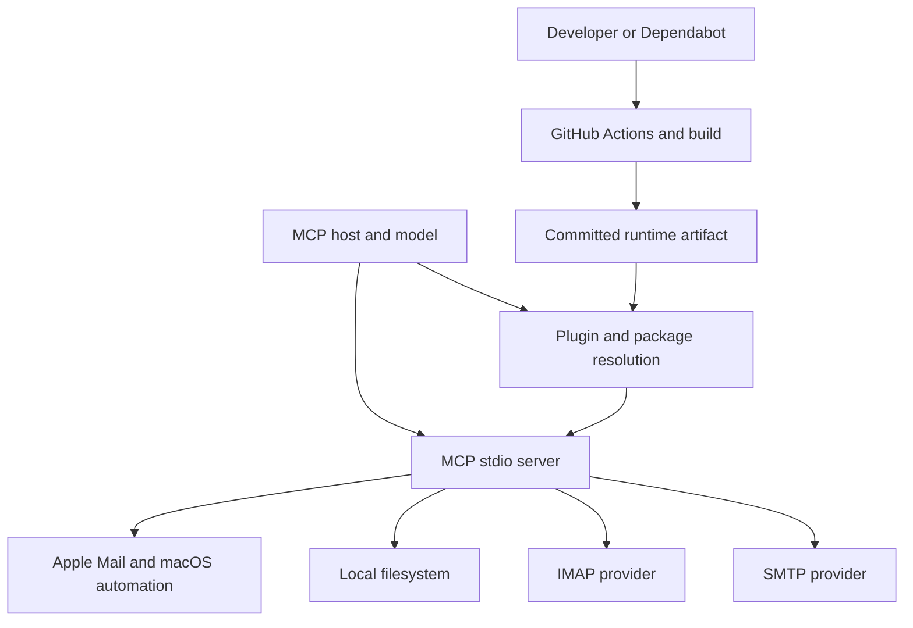

# Apple Mail MCP Threat Model

## Executive summary

This repository is a macOS TypeScript MCP server with authority to read and mutate Apple Mail, send through Mail.app or optional SMTP, access optional IMAP accounts, read local attachment paths, write inbound attachments, and create persistent Mail rules. The highest-risk abuse paths are confused-deputy flows: a hostile email or misled model can turn a broad file path into outbound exfiltration, a numeric Mail id into a wrong-message mutation, or one enabled rule into durable deletion or movement. Existing escaping, path-prefix, mailbox-scoping, forensic, schema, and attachment-size controls are meaningful, but several privileged boundaries still rely on prose, mutable defaults, or broad filesystem and network authority.

## Scope and assumptions

- In scope: runtime behavior under `src/`, the committed `build/` artifact, plugin launch configuration under `codex/`, package and lockfile state, security policy, and Dependabot workflows.
- Out of scope: Apple Mail, Contacts, macOS TCC, the user's Keychain, IMAP/SMTP servers, the MCP host's implementation, and any remote bridge that may expose this stdio process. Those systems are modeled as external boundaries, not as repository code.
- Intended use: an MCP server used to control personal or organizational Apple Mail from an AI host.
- Native deployment: the repository starts a stdio MCP transport and supplies no authentication, tenant isolation, or authorization layer. Any host or wrapper that exposes it to remote or multi-user clients must provide authentication and authorization before forwarding calls.
- Optional services: SMTP and IMAP are inert until configured (`~/Library/Application Support/apple-mail-mcp/config.json` plus Keychain credentials). Every tool is registered unconditionally at startup, including the Contacts, smart-mailbox and filesystem-attachment tools — those are gated by macOS TCC and the filesystem boundary at call time, not by registration. The default AppleScript mail path is local to the Mac, but it still has the Mail.app authority granted by macOS TCC.
- Attachment writes: `save-attachment` is constrained to the home directory, `/tmp`, `/private/tmp`, and `/Volumes`; canonicalization, path-segment checks, traversal rejection, symlink checks, and exclusive creation protect the destination boundary.
- Data sensitivity: mailbox contents, attachment bytes, contact data, message metadata, credentials obtained through the macOS Keychain, SMTP/IMAP traffic, and local files reachable by attachment paths are sensitive.
- Attacker assumption: an attacker can influence email content, attachment names and bytes, prompt context, or a connected model's tool arguments, but cannot directly edit the local repository or invoke macOS APIs outside the MCP unless the host grants that path.

The ranking below treats hostile mail, prompt injection, and unsafe tool arguments as in scope. It treats remote exposure as conditional on a wrapper: the repository does not claim to secure a wrapper that it does not implement.

## System model

### Primary components

- `src/index.ts` is the MCP entrypoint. It registers tool schemas and handlers, routes numeric ids to AppleScript and `imap:` ids to IMAP, and starts `StdioServerTransport`.
- `src/services/appleMailManager.ts` is the AppleScript authority for account discovery, message reads and mutations, attachments, rules, contacts, and smart-mailbox operations. It executes `osascript` through `src/utils/applescript.ts`.
- `src/services/imapClient.ts` is the optional IMAP authority. It resolves credentials from environment or Keychain, maintains pooled connections, reads messages and attachments, and performs server-side mutations.
- `src/services/smtpMailer.ts` is the optional outbound network authority. It resolves SMTP credentials and sends MIME through Nodemailer.
- `src/utils/attachmentMaterialize.ts` and the attachment builders in `appleMailManager.ts` and `smtpMailer.ts` turn tool arguments into local file reads or temporary files.
- `codex/.mcp.json` and the plugin manifests define how a host starts the server. The marketplace manifest pins an exact `apple-mail-mcp` version (#166) and `scripts/sync-plugin-version.mjs` rewrites that pin on every bump. The optional standalone archive instead launches its included server bundle (#336). These distribution paths have different provenance boundaries; a version pin alone is not an integrity/hash binding.
- `.github/workflows/dependabot-automerge.yml` and `.github/workflows/dependabot-rebuild.yml` govern automated dependency changes and committed bundle regeneration. They are CI/build surfaces, not runtime controls.

### Data flows and trust boundaries

- MCP host -> `src/index.ts`: tool arguments, ids, mailbox names, recipient addresses, rule definitions, attachment paths, and base64 bytes cross a local stdio boundary. Zod schemas validate many shapes and sizes; there is no authentication or per-caller authorization in the repository.
- `src/index.ts` -> `appleMailManager.ts`: validated arguments cross an in-process boundary into AppleScript generation. Numeric values are coerced and many strings are escaped; authorization is mostly tool semantics and descriptions rather than a capability gate.
- `appleMailManager.ts` -> macOS Mail.app: Apple Events and `osascript` cross a privileged automation boundary. macOS TCC controls whether the process may automate Mail, but the repository does not distinguish callers or restrict which authenticated user may invoke a tool.
- MCP host -> local filesystem attachment readers: attachment paths are canonicalized with the native filesystem spelling and must be regular files inside the home directory, `/Volumes`, temporary roots, or additive configured roots. Hidden segments and credential paths remain denied inside allowed roots; application-state paths are protected by default, with explicit narrow-root exemptions. Temporary directories remain a world-writable convenience boundary; this policy does not prove that all allowed content is suitable to send.
- Mail.app or IMAP -> local filesystem attachment writers: email-controlled filenames and bytes cross into `saveAttachment` or the IMAP save handler. Save roots and traversal/symlink checks exist, and existing destinations are rejected by exclusive creation.
- `src/index.ts` -> `imapClient.ts` -> IMAP server: account labels, mailbox paths, UIDs, searches, attachment sections, and mutations cross an authenticated TLS boundary. IMAP ids encode account, path, and UID; attachment buffering remains a separate availability concern.
- `src/index.ts` -> `smtpMailer.ts` -> SMTP server: recipient data, message content, local attachment paths, and Keychain-backed credentials cross an outbound network boundary. Non-implicit-TLS SMTP requires STARTTLS.
- Developer or Dependabot PR -> GitHub Actions -> committed `build/`: dependency-selected code is installed and built in CI. npm dependency PRs that alter `package.json` or `build/` remain for human review. The narrower lockfile-only automerge path requires a successful rebuild and a changed-file check; GitHub Actions updates have their own automerge policy. A reproducible bundle proves source/build consistency, not the trustworthiness of its dependencies.
- Plugin install -> npm registry -> launched server: `codex/.mcp.json` invokes `npx -y apple-mail-mcp@<exact-version>` (pinned by #166, kept in sync by CI). The version is no longer a separate trust claim, but npm resolution still has no integrity/hash binding, so a registry compromise could serve different bytes for that same version.

#### Diagram

## Assets and security objectives

| Asset                                              | Why it matters                                                                     | Security objective (C/I/A) |
| -------------------------------------------------- | ---------------------------------------------------------------------------------- | -------------------------- |
| Mailbox contents and attachment bytes              | Personal, business, and potentially regulated communications                       | C/I                        |
| Send authority and recipient lists                 | Misuse can create irreversible external communications or data leaks               | I                          |
| SMTP and IMAP credentials                          | Keychain-backed credentials grant network mailbox access                           | C/I                        |
| Local files exposed as attachments                 | Home-directory files may contain tokens, keys, browser data, and private records   | C                          |
| Inbound attachment destination files               | Overwrite can corrupt configuration, shell startup, or user data                   | I/A                        |
| Persistent Mail rules                              | A rule can continue deleting or moving mail after the initiating conversation ends | I/A                        |
| Mailbox placement and message identity             | A wrong numeric-id target can silently mutate a different copy                     | I                          |
| Committed `build/` and plugin launch configuration | These determine the bytes and authority users execute                              | I                          |
| MCP server availability and memory                 | Large attachment downloads or queued operations can starve the local agent         | A                          |
| Audit and error records                            | Forensics must remain trustworthy during destructive operations                    | I                          |

## Attacker model

### Capabilities

- Supply or influence email subjects, bodies, attachment filenames, attachment bytes, and message metadata through a provider or a sender.
- Influence an AI model or MCP client through prompt injection, misleading mailbox content, or ambiguous natural-language requests so it emits valid but unsafe tool arguments.
- Reach the MCP through the configured host boundary. A deployment that adds a remote or multi-user wrapper must provide authentication and authorization there.
- Trigger valid paths, mailbox names, numeric ids, `imap:` ids, rule definitions, and network configuration values that the repository accepts.
- Cause large or repeated reads and attachment fetches within the limits the host imposes.

### Non-capabilities

- Direct repository write access, GitHub maintainer privileges, or the ability to change a committed workflow are not assumed for a runtime attacker.
- Direct Keychain extraction, Mail.app automation, or arbitrary local file access outside the server's granted process authority is not assumed; these are consequences to protect, not attacker prerequisites.
- A remote client is not considered authenticated merely because it can reach a wrapper. If the wrapper has no identity and authorization layer, that is an exposure assumption and a separate deployment defect.

## Entry points and attack surfaces

| Surface                   | How reached                                        | Trust boundary                               | Notes                                                                                                                                         | Evidence (repo path / symbol)                                                              |
| ------------------------- | -------------------------------------------------- | -------------------------------------------- | --------------------------------------------------------------------------------------------------------------------------------------------- | ------------------------------------------------------------------------------------------ |
| Tool arguments            | MCP `tools/call` over stdio or a host wrapper      | Host to runtime                              | Schemas validate shape but not caller authority                                                                                               | `src/index.ts` `registerTool`                                                              |
| Numeric message mutations | `delete-message`, `move-message`, six batch tools  | Runtime to Mail.app                          | Location-aware resolution and ambiguity refusal; explicit numeric batch scope requires both account and mailbox                               | `src/services/appleMailManager.ts` `resolveById`, `findMessageScript`, `resolveBatchScope` |
| Attachment path input     | `send-email`, `create-draft`, CLI attachment flags | Runtime to local files and SMTP/Mail.app     | Canonical allowed roots plus hidden/credential/application-state denials; approved-root content still requires send authorization             | `src/utils/attachmentReadPolicy.ts`, `src/services/smtpMailer.ts` `buildAttachments`       |
| Attachment save           | `save-attachment`                                  | Mail/IMAP to local filesystem                | Existing destinations are refused; private staging/exclusive creation and owner-only file permissions protect saved bytes                     | `resolveAttachmentSaveTarget`, `saveAttachment`, `src/index.ts` IMAP save handler          |
| IMAP attachment fetch     | `fetch-attachment`, IMAP save path                 | IMAP provider to process memory              | buffering is capped by `MAX_IMAP_ATTACHMENT_BYTES`; oversize parts are refused mid-stream                                                     | `src/services/imapClient.ts` `streamToBuffer`, `imapFetchAttachment`                       |
| Raw message acquisition   | `get-message-rfc822` (IMAP-only)                   | IMAP provider to process memory / local file | `EXAMINE` + `BODY.PEEK[]`, no mutation issued; inline capped at 6 MiB, `savePath` at 25 MiB; file written `wx` mode 0600 inside allowed roots | `src/services/imapClient.ts` `imapGetMessageRfc822`, `resolveAttachmentSaveTarget`         |
| Persistent rules          | `create-rule`                                      | MCP to durable Mail.app automation           | New rules default disabled; an explicit `enabled: true` or later `enable-rule` can still create durable destructive behavior                  | `src/index.ts` `create-rule`, `AppleMailManager.createRule`                                |
| Network credentials       | SMTP/IMAP configuration and Keychain reads         | Runtime to providers                         | STARTTLS required without implicit TLS; explicit plaintext opt-outs restore opportunistic behavior and remain a deployment risk               | `src/services/smtpMailer.ts`, `src/services/imapClient.ts`                                 |
| Runtime supply chain      | Plugin install and MCP start                       | Registry/plugin to executable                | Marketplace starts exact-pinned npm code; standalone archive starts included bytes; both depend on trusted release provenance                 | `codex/.mcp.json`, `scripts/package-codex-plugin.mjs`                                      |
| CI artifact promotion     | Dependabot PRs and workflow pushes                 | Developer intent to shipped build            | Dev toolchain changes can alter `build/`                                                                                                      | `.github/workflows/dependabot-automerge.yml`, `dependabot-rebuild.yml`                     |

## Abuse paths and current controls

These are the scenarios this model tracks, including paths already blocked by
shipped controls. They are not a list of currently exploitable defects.

1. **Exfiltrate a local secret:** a malicious message convinces the host to attach a path. Canonical read roots and hidden/credential/application-state checks block protected paths; allowed files can still contain sensitive information. The host must authorize the actual file and recipient.
2. **Corrupt an existing file:** an inbound attachment targets an existing destination. Both backends refuse that overwrite through exclusive creation; the AppleScript path first stages privately. A successful save is not permission to execute the downloaded file.
3. **Mutate the wrong message:** a numeric id occurs in several mailboxes. The shared location-aware resolver refuses ambiguous unlocated matches, and explicit batch scope requires account plus mailbox. Caller-supplied or previously remembered scope still has to represent the user's intended copy.
4. **Install durable deletion:** a caller creates a rule with delete/move actions. New rules default disabled. Explicit `enabled: true` or `enable-rule` can still make the rule act on future mail, so the host must authorize that persistent effect.
5. **Purge an already-trashed message:** an IMAP id names the resolved Trash mailbox. `trashUids` deliberately expunges this case; other mailbox paths move to Trash. A separate permanent-delete opt-in remains an unimplemented design option, not an existing protection.
6. **Exhaust attachment buffering:** a provider advertises or streams an oversized part. The declared-size check and streamed `MAX_IMAP_ATTACHMENT_BYTES` ceiling bound a single IMAP attachment. They do not establish a process-wide memory budget for all simultaneous operations.
7. **Expose credentials or mail in transit:** non-implicit-TLS connections require STARTTLS. An operator can explicitly enable the documented plaintext opt-out; IMAP and SMTP then upgrade opportunistically and can proceed without TLS when the server does not offer it.
8. **Run unreviewed code:** the marketplace launches an exact-pinned npm version, while the standalone archive launches its included bundle. A compromise of the relevant package/release source remains material; the version pin and a reproducible build alone do not authenticate downloaded bytes.
9. **Promote a generated build without review:** a dependency change alters shipped bytes. npm changes to `package.json` or `build/` remain for human review; lockfile-only automerge requires a successful rebuild and an exact changed-file check. Full CI must also pass for the exact main commit before publication.

## Threat model table

| Threat ID | Scenario and impact                                                | Current repository controls                                                                                                                                                                                  | Residual boundary / next decision                                                                                                                                                                                                  |
| --------- | ------------------------------------------------------------------ | ------------------------------------------------------------------------------------------------------------------------------------------------------------------------------------------------------------ | ---------------------------------------------------------------------------------------------------------------------------------------------------------------------------------------------------------------------------------- |
| TM-001    | Outbound attachment reads disclose local secrets.                  | Native realpath canonicalization, default/additive roots, hidden and credential denials, default application-state protection, and inline-byte limits.                                                       | The home directory and temporary roots contain files with different sensitivities. Explicit narrow roots may allow application-state paths; hidden and credential denials remain. Authorizing a send is the host's responsibility. |
| TM-002    | Inbound attachment save overwrites a local file.                   | Shared destination checks; AppleScript/MIME private staging with `COPYFILE_EXCL`; IMAP exclusive `wx` writes; owner-only saved files.                                                                        | Overwrite is deliberately unsupported. Filesystem checks do not make an attacker-writable destination directory trustworthy.                                                                                                       |
| TM-003    | An ambiguous numeric id targets the wrong mailbox copy.            | Shared location-aware resolver, ambiguity refusal, atomic account+mailbox batch scope, and source-scoped reply/forward identity checks.                                                                      | Scope must still identify the intended copy. An unseen numeric id can require a bounded scan with incomplete coverage; IMAP ids carry account/mailbox/UID identity.                                                                |
| TM-004    | A rule creates persistent destructive behavior.                    | New rules default disabled; explicit enable/disable tools and destructive-action descriptions.                                                                                                               | A caller can still explicitly create an enabled rule. The local stdio server does not supply a separate per-caller authorization service.                                                                                          |
| TM-005    | Deleting an IMAP message already in Trash permanently removes it.  | Non-Trash deletes move to resolved Trash; already-Trash expunge is a documented capability.                                                                                                                  | A `permanent: true` parameter or explicit purge gate was proposed in #163 but not implemented. Changing that contract requires a separate product decision.                                                                        |
| TM-006    | Large attachment streams exhaust memory.                           | `BODYSTRUCTURE` size pre-check plus a streamed decoded-byte ceiling; oversized parts fail before concatenation/base64 allocation.                                                                            | Per-attachment bounds are not global concurrency or memory limits. The provider remains an external trust boundary.                                                                                                                |
| TM-007    | A server omits STARTTLS and obtains plaintext credentials/content. | IMAP `doSTARTTLS: true` and SMTP `requireTLS: true` without implicit TLS; shared IMAP policy also covers IDLE.                                                                                               | Explicit plaintext opt-outs relax the requirement to opportunistic TLS. They do not bypass certificate validation or force TLS off.                                                                                                |
| TM-008    | Plugin startup executes bytes different from the reviewed release. | Exact npm version pin synchronized by CI; optional standalone archive includes the committed bundle and launches it directly.                                                                                | Neither a version label nor an unauthenticated checksum proves publisher identity. Marketplace resolution and release-archive provenance must be assessed separately.                                                              |
| TM-009    | Automation ships a changed generated bundle without review.        | npm PRs changing shipped bytes remain for human review; lockfile-only automerge checks the successful rebuild and changed files; publication requires full CI for the exact main SHA and archive validation. | These gates establish review/build provenance, not dependency correctness. Review changes to workflow permissions and promotion rules as security-sensitive code.                                                                  |

## Status of the original hardening findings

This table records the disposition of the original findings. "Closed" applies to the named defect and its regression coverage; it does not close the broader threat scenario or establish trust in a host wrapper, Mail.app, a provider, or a package registry.

| Threat                                             | Status         | Evidence                                                                                                                                                  |
| -------------------------------------------------- | -------------- | --------------------------------------------------------------------------------------------------------------------------------------------------------- |
| TM-001 — outbound local-file exfiltration          | Closed         | #168 added canonical roots and protected-path checks; #320 extended application-state protection. Allowed-root content still requires send authorization. |
| TM-002 — inbound attachment overwrite              | Closed         | #161 uses private staging/exclusive creation and owner-only final files; existing destinations are refused on both backends.                              |
| TM-003 — wrong numeric-message target              | Closed         | #160 uses recorded location first and refuses unlocated multi-mailbox ambiguity for reads and mutations.                                                  |
| TM-004 — enabled destructive Mail rule             | Closed         | #164 creates rules disabled unless `enabled: true`; review can happen before `enable-rule`.                                                               |
| TM-005 — empty-Trash expunge                       | Open follow-up | #163 was intentionally declined because empty-Trash expunge is a documented capability; a separate explicit purge opt-in requires a product decision.     |
| TM-006 — oversized IMAP attachment memory pressure | Closed         | #162 enforces the attachment ceiling before buffering and documents the user-visible refusal.                                                             |
| TM-007 — plaintext SMTP/IMAP downgrade             | Closed         | #171 (continuing #165) requires STARTTLS for non-implicit-TLS transports and documents the explicit plaintext escape hatch.                               |
| TM-008 — runtime provenance                        | Residual risk  | The unpinned launcher was fixed by #166. #336 added a bundled standalone archive; marketplace and archive provenance remain separate trust boundaries.    |
| TM-009 — unreviewed generated-build promotion      | Closed         | #167's policy change was carried forward and merged as the maintainer continuation #170.                                                                  |

## Criticality calibration

Severity describes the consequence of a scenario if its controls fail; it does
not reopen a closed finding or establish that the current implementation is
exploitable.

- **Critical:** disclosure of sensitive local/mailbox data, wrong-message sends, or execution of compromised release code with the host's privileges.
- **High:** permanent mail loss, destructive persistent rules, or corruption of local files.
- **Medium:** bounded availability failures, incomplete coverage, or a weakened transport guarantee under an explicit deployment opt-out.
- **Low:** documentation or test-contract drift without a demonstrated runtime failure. Production schemas are shared with tests; any claim of renewed duplication needs a concrete example.

## Focus paths for security review

| Path                                         | Why it matters                                                                                       | Related Threat IDs             |
| -------------------------------------------- | ---------------------------------------------------------------------------------------------------- | ------------------------------ |
| `src/index.ts`                               | Tool schemas, routing, send/destructive handlers, rule defaults, and the actual enforcement boundary | TM-001, TM-003, TM-004, TM-005 |
| `src/services/appleMailManager.ts`           | AppleScript authority, numeric-id lookup, attachment paths, and persistent rules                     | TM-002, TM-003, TM-004         |
| `src/services/imapClient.ts`                 | Credential resolution, TLS options, UID mutations, Trash behavior, and attachment streaming          | TM-005, TM-006, TM-007         |
| `src/services/smtpMailer.ts`                 | Outbound network authority and local attachment reads                                                | TM-001, TM-007                 |
| `src/utils/attachmentMaterialize.ts`         | Local file materialization before Mail.app sends                                                     | TM-001                         |
| `src/utils/attachmentLimits.ts`              | Shared size contracts for inline and IMAP attachment boundaries                                      | TM-006                         |
| `src/security.test.ts`                       | Security tests import production schemas; retain positive and negative boundary cases                | TM-001, TM-003                 |
| `codex/.mcp.json`                            | Exact-pinned (#166); npm resolution still lacks an integrity/hash binding                            | TM-008                         |
| `.github/workflows/dependabot-automerge.yml` | Restricts npm automerge to successful lockfile-only rebuilds                                         | TM-009                         |
| `.github/workflows/dependabot-rebuild.yml`   | Rebuilds and pushes generated runtime bytes with a write token                                       | TM-009                         |
| `SECURITY.md`                                | Public policy currently describes broad filesystem and confirmation expectations                     | TM-001, TM-002, TM-004         |

## Notes on use

This model separates runtime authority from CI/build policy. It treats existing controls as evidence, not as proof that a caller is authorized. The broader-exposure assumption is conditional: the repository itself starts a local stdio transport, so a remote threat exists only if the host or wrapper exposes it; if that wrapper is strictly single-user and authenticated, TM-003 and TM-004 likelihood should be reduced but not removed because prompt injection and malicious email remain in scope. Changes to remote exposure, permissions, permanent deletion, or allowed path roots require their own explicit design and review; a documentation refresh does not grant those capabilities.
